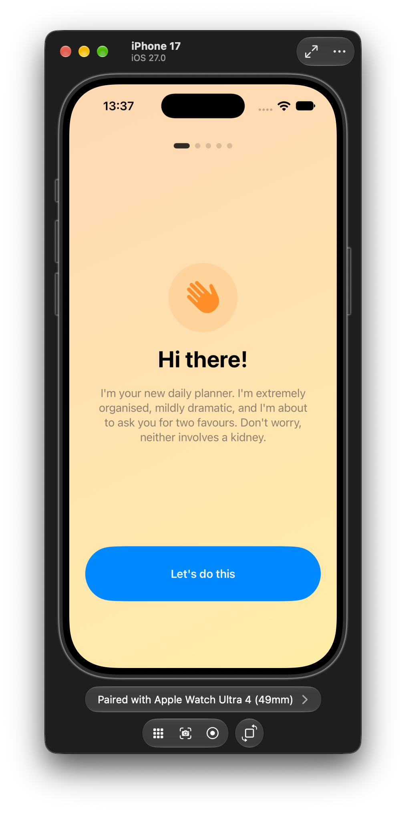
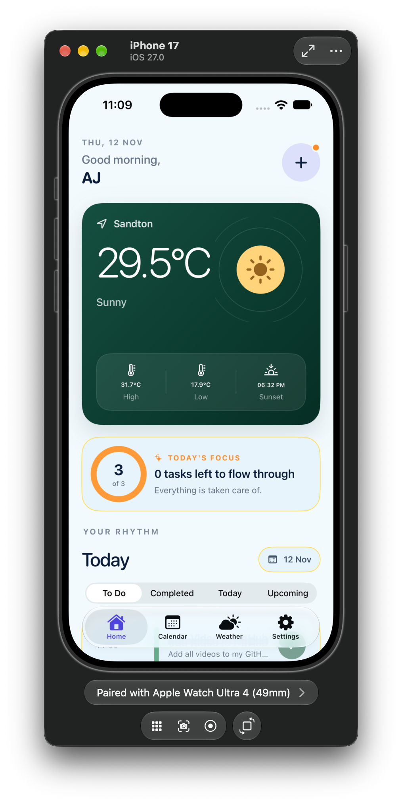
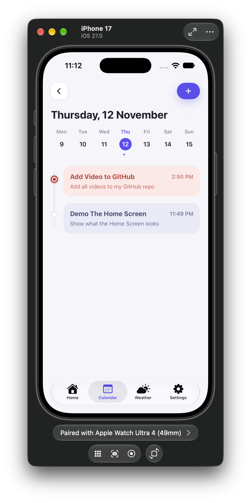
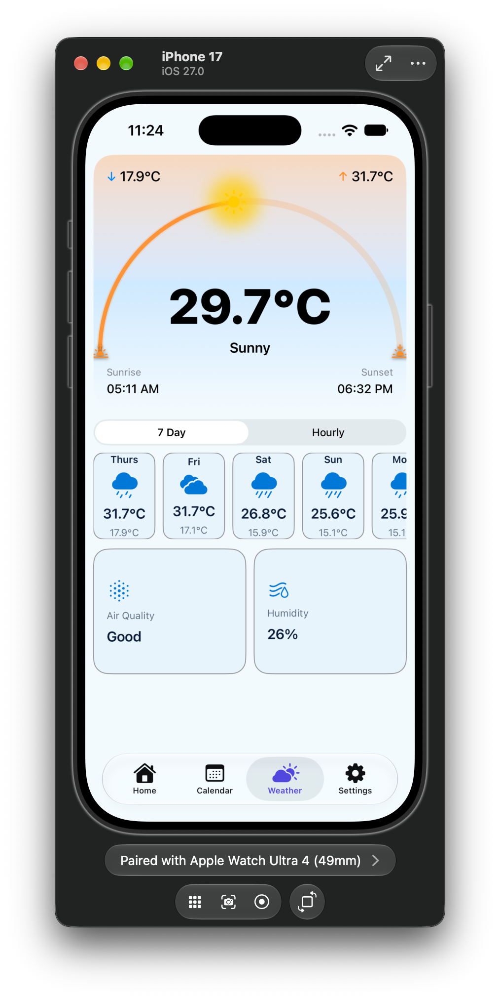
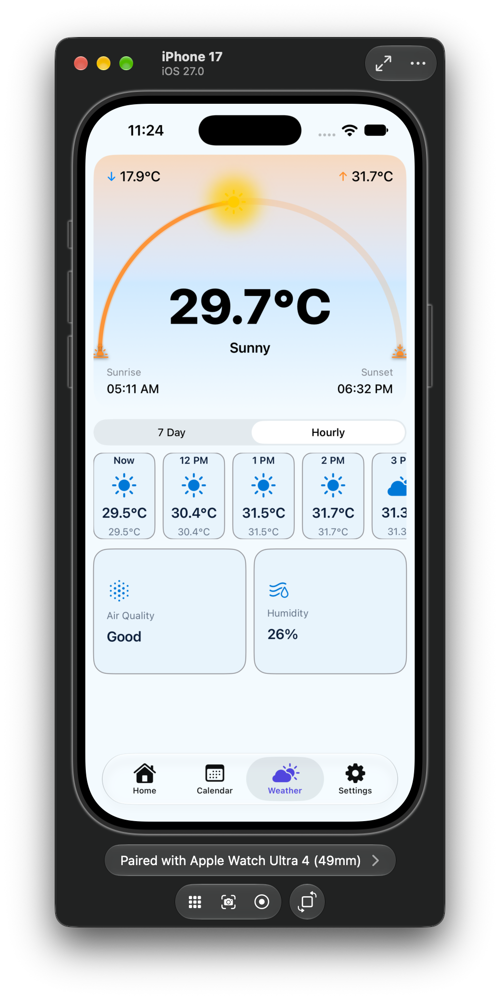
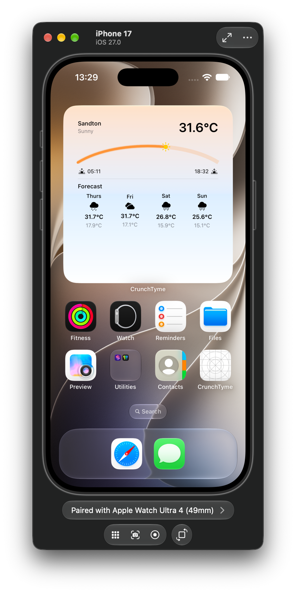

# CrunchTyme — Daily Planner & To-Do

**Plan your tasks, see your schedule, and keep an eye on the weather.**


CrunchTyme is a native iPhone and iPad daily planner built with SwiftUI. It brings locally stored tasks, a weekly calendar with a daily timeline, and weather information into one app, helping you review what needs doing and when. A companion WidgetKit extension displays a saved weather snapshot outside the app.

The Xcode project and app target are named `DailyPlanner_ToDo`; the configured display name is **CrunchTyme**. This is a work in progress: Settings and some weather details are currently placeholders.

## Contents

- [Features and demos](#features-and-demos)
- [Tech stack](#tech-stack)
- [Architecture](#architecture)
- [Getting started](#getting-started)
- [Testing](#testing)
- [Deployment](#deployment)
- [Roadmap](#roadmap)
- [Contributing](#contributing)
- [License](#license)

## Features and demos

The video and screenshot links below are placeholders. Save recordings under `docs/videos/` and screenshots under `docs/images/`; these files are not included yet.

### Onboarding and personalization

A five-step flow introduces the app, collects a first name, offers location permission, explains local storage, and confirms setup. Buttons and horizontal swipes navigate the flow. A nonempty trimmed name is required to advance past the name screen. Location access can be deferred; denied access exposes a link to iOS Settings.

**Technologies and patterns:** SwiftUI state-driven navigation, `@FocusState`, `@AppStorage` for `userName` and `hasCompletedOnboarding`, and an observable Core Location service injected through the environment. The display name is local; there is no account registration or authentication flow.

**Demo:** Record first launch, enter a name, show the location choice, and finish onboarding.

<!-- TODO: add demo video for Onboarding -->
[▶ Watch the Onboarding demo](docs/videos/onboarding.mp4)

<!-- TODO: add screenshot for Onboarding -->


### Home dashboard and task tracking

Home greets you by name and time of day, shows the current date and weather summary, and lists tasks ordered by due date. Completion controls toggle a task's state. A progress ring and remaining count summarize the **currently selected filter**, even though the card is labeled “Today's Focus.”

| Filter | Tasks shown |
| --- | --- |
| To Do | All tasks, including completed tasks |
| Completed | Completed tasks |
| Today | Tasks due today, including completed tasks |
| Upcoming | Incomplete tasks with a due date later than now |

**Technologies and patterns:** reusable SwiftUI components, SwiftData `@Query`, observable `TaskViewModel`, protocol-injected `FilterUseCase`, named color assets, and accessibility labels on completion controls.

**Demo:** Switch filters, complete and reopen a task, and show the changing progress summary.

<!-- TODO: add demo video for Home Dashboard -->
[▶ Watch the Home Dashboard demo](docs/videos/home-dashboard.mp4)

<!-- TODO: add screenshot for Home Dashboard -->


### Task creation and local persistence

The plus button on Home or Calendar opens a task sheet. Enter a title, description, and due date/time, then save. The date picker permits dates from the present onward. Tasks store an identifier, title, description, completion state, and due date in the app's SwiftData model container.

**Technologies and patterns:** SwiftUI sheet presentation, `DatePicker`, SwiftData `@Model` and `ModelContext`, and task creation through `TaskViewModel`.

**Current scope:** the view model contains update and delete methods, but the visible interface does not expose editing or deletion. The form currently allows empty titles and logs save failures to the debug console.

**Demo:** Create a task, find it on Home and Calendar, then relaunch to demonstrate persistence.

<!-- TODO: add demo video for Task Creation -->
[▶ Watch the Task Creation demo](docs/videos/task-creation.mp4)

<!-- TODO: add screenshot for Task Creation -->


### Calendar and daily timeline

Browse horizontally paged, Monday-first weeks and select a day to see its tasks in chronological order. Indicators mark today and dates containing tasks. The timeline displays titles, notes, and due times with colored cards, highlighting the next task due today. The default range spans six months before and after the reference date.

**Technologies and patterns:** generic `CalendarView<Task: CalendarTask>`, a protocol adapter on the persisted task model, observable `CalendarViewModel`, Foundation calendar calculations, and SwiftUI scroll paging.

**Current scope:** the header's back button has an empty action.

**Demo:** Page through weeks, select days with and without tasks, and show a scheduled day's timeline.

<!-- TODO: add demo video for Calendar Timeline -->
[▶ Watch the Calendar Timeline demo](docs/videos/calendar-timeline.mp4)

<!-- TODO: add screenshot for Calendar Timeline -->


### Weather dashboard and forecasts

The Weather tab displays temperature in Celsius, conditions, daily high/low temperatures, sunrise/sunset, and a sun/moon progress arc. A segmented control switches between “7 Day” and hourly forecast cards. The mapper selects hourly entries within the next 24-hour window, starting at the current hour. Initial loading uses shimmer skeletons that respect Reduce Motion.

**Technologies and patterns:** `URLSession` with `async/await`, `Codable` responses, service/repository protocols, a response-to-domain mapper, shared observable weather state, SF Symbols, condition/day-night gradients, and timer-driven sun-cycle rendering.

**Current scope:** the request asks WeatherAPI for seven days; the displayed forecast depends on returned data. Air Quality (“Good”) and Humidity (“62%”) tiles are static examples. Fetch failures are logged without a dedicated error/retry screen. Additional atmosphere drawing components exist in source but are not wired into the current weather hero.

**Demo:** Show the Home weather summary, open Weather, and switch daily/hourly forecasts. Identify static detail tiles as placeholders.

<!-- TODO: add demo video for Weather Dashboard -->
[▶ Watch the Weather Dashboard demo](docs/videos/weather-dashboard.mp4)

<!-- TODO: add screenshots for Weather Dashboard -->



### Companion weather widget

The widget reads the last weather snapshot saved by the app and presents temperature, conditions, sunrise/sunset, and a sun/moon arc. Layout branches for larger families include up to four forecast cards. Without saved data, the timeline displays “Weather unavailable.”

**Technologies and patterns:** WidgetKit `StaticConfiguration` and `TimelineProvider`, shared `Codable` payloads, App Group `UserDefaults`, and `WidgetCenter` reloads after successful app fetches. The provider requests another timeline after 30 minutes; it rereads saved data rather than fetching weather itself. iOS controls actual refresh timing.

**Current scope:** The basic layout declares `crunchtyme://weather`, and the app handles that URL to select Weather, but no URL-scheme registration is present in the app configuration. The larger layouts do not declare that widget URL. Families are not explicitly restricted with `supportedFamilies`; verify available layouts on the intended device and OS.

**Demo:** Fetch weather in the app, add the widget to the Home Screen, and show its saved weather and sun arc.

<!-- TODO: add demo video for Weather Widget -->
[▶ Watch the Weather Widget demo](docs/videos/weather-widget.mp4)

<!-- TODO: add screenshot for Weather Widget -->


### Other screens and implementation status

The tab bar contains Home, Calendar, Weather, and Settings. **Settings currently displays only a title and icon.** Separate Air Quality and Humidity detail views are placeholders. No backend server, user authentication, cloud task synchronization, or notification scheduling is implemented, however notification scheduling and user profiles are planned for the future.

<!-- TODO: add a Settings feature demo when functional settings are implemented. -->

## Tech stack

| Category | Technologies used |
| --- | --- |
| Language | Swift; build settings use Swift 5 language mode |
| UI | SwiftUI, SF Symbols, asset catalogs, limited UIKit integration |
| State and navigation | Observation (`@Observable`), `@State`, `@Environment`, `@AppStorage`, `NavigationStack`, `TabView` |
| Local storage | SwiftData for tasks; UserDefaults for onboarding and widget snapshots |
| Networking | Foundation `URLSession`, `async/await`, `JSONDecoder`, `Codable` |
| External service | [Open-Meteo forecast and geocoding APIs](https://open-meteo.com/en/docs); no project backend |
| Location | Core Location, one-shot requests, when-in-use authorization |
| Widgets | WidgetKit, App Groups, shared models and storage |
| Timers | Combine timer publisher for sun-cycle updates |
| Tests | XCTest; Swift Testing is imported but no Swift Testing tests are defined |
| Build and distribution | Xcode project, shared schemes, `xcodebuild`, automatic code signing |
| Authentication | No user authentication implemented |

There are no declared third-party Swift Package, CocoaPods, or Carthage dependencies. Weather requests use HTTPS and require no embedded credentials.

## Architecture

The app uses component-based SwiftUI views with MVVM-style view models and `Data`, `Domain`, and `Presentation` folders. Weather and task filtering use protocol-based dependency injection. These are organizational layers rather than separate Swift packages: task views and their view model access SwiftData directly, however a repository is planned to be implemented as a layer between these concerns.

```text
DailyPlanner_ToDo/
├── README.md
├── DailyPlanner-ToDo-Info.plist       # App permissions and transport configuration
├── DailyPlanner_ToDo.xcodeproj/      # App, widget, test targets and shared schemes
├── DailyPlanner_ToDo/
│   ├── DailyPlanner_ToDoApp.swift    # Entry point, onboarding gate, model container
│   ├── LocationService.swift        # Observable Core Location delegate adapter
│   ├── Assets.xcassets/             # Named colors and app icon catalog
│   ├── Data/
│   │   ├── Model/                   # SwiftData Task and weather response models
│   │   ├── Network/WeatherService.swift
│   │   ├── WeatherMapper.swift
│   │   └── WeatherConditionMapper.swift
│   ├── Domain/                      # Protocols, use cases, weather/shared models
│   ├── Presentation/
│   │   ├── Root/                    # Tab navigation and placeholder Settings
│   │   ├── Onboarding/
│   │   ├── Home/                    # Early placeholder view
│   │   ├── Task/                    # Actual Home UI, task components and view model
│   │   ├── Calendar/
│   │   ├── ViewModel/               # Calendar and weather view models
│   │   └── Weather/                 # Hero, forecasts, sun cycle, details, utilities
│   ├── DailyPlanner_ToDo.entitlements
│   └── DailyPlanner_ToDoTests.xctestplan
├── CrunchTymeWeatherWidget/
│   ├── CrunchTymeWeatherWidgetBundle.swift
│   ├── Shared/WeatherDataStore.swift
│   ├── Widget/                      # Timeline provider and widget layouts
│   ├── Assets.xcassets/
│   └── Info.plist
├── CrunchTymeWeatherWidgetExtension.entitlements
├── DailyPlanner_ToDoTests/           # Weather networking, mapping and snapshot tests
└── ToDoApp/.gitattributes            # Line-ending configuration only
```

**App lifecycle:** `DailyPlanner_ToDoApp` supplies the task model container and location service, then chooses onboarding or `RootTabView` using the stored onboarding flag. The root owns a weather view model shared by Home and Weather and loads weather when location authorization changes.

**Weather flow:** view → `WeatherViewModel` → `WeatherRepositoryProtocol` → `WeatherServiceProtocol` → Open-Meteo. `WeatherMapper`, called by the repository, converts provider-specific DTOs into the existing application models. `WeatherConditionMapper` groups WMO codes into the condition strings and SF Symbols already consumed by the views. Optional measurements use °C, %, mm, and km/h. Forecast dates are decoded as Unix timestamps and formatted in the returned location timezone. After a successful fetch, the view model saves `SharedWeatherData` and asks WidgetKit to reload.

**Task flow:** `AddTaskView` → `TaskViewModel` → SwiftData `ModelContext`. Queries supply tasks to Home and Calendar; `FilterUseCase` selects categories, while `CalendarViewModel` filters and sorts by day.

**Shared widget code:** Xcode target membership shares weather payloads, date/day helpers, appearance code, and `WeatherDataStore` across the app and extension. Check membership when moving shared files.

## Getting started

### Prerequisites

- A Mac with Xcode and an iOS SDK/runtime supporting the checked-in deployment targets.
- The app currently inherits **iOS 26.5** from the project. Tests declare iOS 26.5 and the widget declares iOS 18.6; the app's higher minimum still governs installation of the app and its embedded widget.
- A compatible iPhone/iPad simulator or device.
- Internet access for Open-Meteo forecast requests and city geocoding; no API key is required for standard free non-commercial access.
- For device builds/distribution, an Apple development team with signing and App Group provisioning.

<!-- TODO: document the minimum tested Xcode version and align deployment targets after verifying API availability. -->

### Installation

```bash
git clone https://github.com/glucode-aj/DailyPlanner_ToDo.git
cd DailyPlanner_ToDo
```

Open `DailyPlanner_ToDo.xcodeproj` in Xcode. No separate dependency installation is currently required.

### Configuration and environment variables

**No application environment variables or API keys are required.** The service uses Open-Meteo’s standard public HTTPS endpoints. See the [forecast documentation](https://open-meteo.com/en/docs) and [geocoding documentation](https://open-meteo.com/en/docs/geocoding-api) for parameters and service terms.

| Configuration | Current behavior / setup |
| --- | --- |
| Weather provider | `WeatherService` requests Open-Meteo over HTTPS; the prior embedded credential has been removed. |
| Weather location | The existing `city` argument accepts a city name or `latitude,longitude`. City names are geocoded; location permission handling and the Sandton fallback remain in `RootTabView`. |
| Location permissions | The root `DailyPlanner-ToDo-Info.plist` contains usage descriptions; the service requests when-in-use permission. |
| App Group | Both entitlement files and `WeatherDataStore.suiteName` must use the same group registered for your team. The current identifier is `group.com.alfrxdjr.DailyPlanner-ToDo`. |
| Signing | Select your team under Signing & Capabilities for the app and widget; adjust bundle identifiers and provisioning as needed. |
| Widget debugging | The widget scheme defines `_XCWidgetKind`, `_XCWidgetDefaultView`, and `_XCWidgetFamily`. These are Xcode launch settings, not application credentials. |

<!-- TODO: revoke the former provider credential if it remains active; removing it from source does not invalidate copies in Git history. -->
<!-- TODO: register the crunchtyme URL scheme and verify widget-to-weather navigation. -->

### Run locally

1. Select the **DailyPlanner_ToDo** scheme.
2. Choose a compatible iPhone or iPad simulator/device.
3. Build and run with **⌘R**.
4. Complete onboarding. Allow location access to request local weather, or defer it to use the Sandton fallback.
5. Create a task from Home or Calendar. After a successful weather fetch, add the Weather widget from the widget gallery, or use the **CrunchTymeWeatherWidgetExtension** scheme to debug it.

Tasks and onboarding preferences use local storage, so task planning does not depend on weather requests succeeding. Reinstalling the app in a simulator provides fresh onboarding but also removes that installation's local tasks and preferences.

## Testing

`DailyPlanner_ToDoTests` includes the original weather mock smoke test and `OpenMeteoWeatherTests`. Deterministic tests use a stub `URLProtocol` to verify city/coordinate requests, HTTP/decoding/network failures, WMO mappings, optional forecast values, timezone formatting, repository output, view-model state, and App Group snapshot compatibility. They do not require a live API connection. Task persistence, task filters, calendar behavior, and widget visual layouts still need dedicated coverage.

In Xcode, select **DailyPlanner_ToDo** or **DailyPlanner_ToDoTests** and use **⌘U**. The dedicated test scheme references `DailyPlanner_ToDo/DailyPlanner_ToDoTests.xctestplan`.

For command-line testing, list compatible destinations:

```bash
xcodebuild -project DailyPlanner_ToDo.xcodeproj \
  -scheme DailyPlanner_ToDo -showdestinations
```

Replace `SIMULATOR_UDID` with a compatible simulator identifier from that output:

```bash
xcodebuild test \
  -project DailyPlanner_ToDo.xcodeproj \
  -scheme DailyPlanner_ToDo \
  -destination 'platform=iOS Simulator,id=SIMULATOR_UDID'
```

No CI workflow, dedicated UI test target, or lint configuration is included.

<!-- TODO: add tests for task filters/persistence, calendar date boundaries, and widget visual layouts. -->

## Deployment

The app embeds `CrunchTymeWeatherWidgetExtension`. Shared schemes use Release for archiving, and targets use automatic signing. No automated release pipeline or confirmed App Store/TestFlight release information is included.

For a manual distribution build:

1. Configure your team, bundle identifiers, and matching App Group capabilities for the app and widget.
2. Review provider terms and resolve release-blocking implementation gaps. Supply final app icon artwork; the checked-in app icon catalog is not populated.
3. Select **DailyPlanner_ToDo**, choose an appropriate device build destination, and use **Product → Archive**.
4. Use Xcode Organizer to validate and distribute through your chosen Apple distribution method, subject to account and provisioning setup.

<!-- TODO: document the verified distribution channel, release process, and supported device/OS matrix. -->

## Roadmap

These items reflect current implementation gaps, not committed release dates.

- [x] Replace the credential-based weather service with Open-Meteo over HTTPS.
- [x] Support city/coordinate queries and preserve existing models through DTO mapping.
- [x] Add WMO, networking, mapping, and widget snapshot tests.
- [x] Connect humidity to current weather data.
- [ ] Connect air-quality tiles to real data, or label unavailable data.
- [ ] Add visible weather errors and retry controls.
- [ ] Expose task editing/deletion; add form validation and save feedback.
- [ ] Implement Settings; resolve the inactive calendar header action and diagnostic logging.
- [ ] Register and verify widget deep links across layouts and verify family support.
- [ ] Align deployment targets, supply app icon artwork, and expand tests.
- [ ] Add the feature videos and screenshots linked above.

<!-- TODO: confirm roadmap priorities with the maintainer. -->

## Contributing

1. Open an issue describing a bug or proposed improvement.
2. Fork the repository and create a focused branch.
3. Follow the existing SwiftUI component structure and protocol-injected service/use-case patterns.
4. Run existing tests and manually check affected screens. For shared weather changes, check both app and widget targets.
5. Submit a pull request explaining the change and validation, with screenshots or a short recording for UI changes.

Keep credentials, personal signing changes, and Xcode user state out of pull requests. There is no dedicated contribution guide or code of conduct yet.

<!-- TODO: define contribution policies and required checks. -->

## License

No license file is currently included. Reuse and redistribution permissions have not been specified by this repository.

<!-- TODO: choose a license, add a LICENSE file, and update this section. -->
